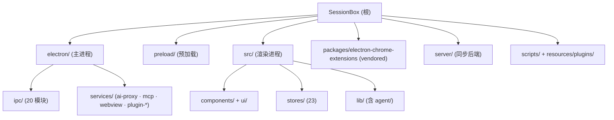

# SessionBox

## 项目简介

SessionBox 是一个基于 **Electron + Vue 3** 的**多账号浏览器管理桌面应用**。通过 `partition` 隔离不同账号的 Cookie/Session，支持分组管理、代理配置、标签页拖拽排序、分屏、Aria2 下载、Chrome 扩展、AI 智能助手（Agent/Chat）、MCP Server、插件系统、操作录制回放与数据同步等。

典型场景：社交媒体多账号运营、电商多店铺管理、多身份浏览、浏览器自动化。

技术栈：Electron 44（三进程）+ electron-vite 构建 + Vue 3 + Pinia（23 Store）+ Tailwind CSS 4 + shadcn-vue(Radix/reka) + Dexie(IndexedDB) + electron-store/JsonStore 持久化 + LangChain（AI Agent）。

## 约定的规则（高优先级）

- 语言全栈 TypeScript；Vue 用 `<script setup lang="ts">`。包管理器固定 **pnpm@10.17.1**。
- 命令：`pnpm dev`（开发）/ `pnpm build`（构建）/ `pnpm pack`（打包）/ `pnpm type-check`（vue-tsc 类型检查）/ `pnpm sync-server[:test]`（同步后端）。**无统一测试运行器**，测试为零散 node:test 文件（见 [claude/testing-and-quality.md](claude/testing-and-quality.md)）。
- **数据模型三处同步**：`src/types/index.ts` ↔ `electron/services/store.ts` ↔ `preload/index.ts`。
- **IPC 三处同步**：`preload/index.ts` ↔ `electron/ipc/*` ↔ `src/types/index.ts`。
- **WebView = WebContentsView**（非 `<webview>` 标签），逻辑在 `electron/services/webview-manager.ts` + `electron/services/webview/`。
- 窗口**无边框透明**（`frame:false, transparent:true`），拖拽靠 CSS；关闭行为由 `minimizeOnClose` 决定。
- AI API Key **仅在主进程** `ai-proxy` 组装，不进入渲染进程。
- `packages/electron-chrome-extensions` 是 **workspace 内 vendored 子包**（GPL，Electron 官方扩展库魔改），改动需同步上游差异。
- 不主动执行 git。

> 更多约定（ESLint 规则、代码风格、设计规范）见 [claude/conventions.md](claude/conventions.md)。

## 文件索引

| 文件 | 用途 | 何时阅读 |
|------|------|----------|
| [claude/overview.md](claude/overview.md) | 架构总览、三进程、数据流、设计取舍 | 了解全局时 |
| [claude/conventions.md](claude/conventions.md) | 命令、代码风格、ESLint、设计规范 | 写代码前 |
| [claude/module-responsibilities.md](claude/module-responsibilities.md) | 模块职责与子域划分 | 定位目录时 |
| [claude/entrypoints.md](claude/entrypoints.md) | 入口文件、构建配置、启动序列 | 调启动/构建时 |
| [claude/public-interfaces.md](claude/public-interfaces.md) | 自定义协议、默认浏览器、MCP、同步 API | 对外接口时 |
| [claude/dependencies-and-config.md](claude/dependencies-and-config.md) | 依赖、配置文件、环境 | 配置/升级时 |
| [claude/data-model.md](claude/data-model.md) | 领域模型关系、四层持久化 | 改数据时 |
| [claude/testing-and-quality.md](claude/testing-and-quality.md) | 测试现状、Lint、质量风险 | 评估质量时 |
| [claude/file-map.md](claude/file-map.md) | 根目录文件与目录地图 | 找文件时 |
| [claude/faq.md](claude/faq.md) | "改 X 看 Y"导航、关键注意、已知不一致 | 排错/定位时 |
| [claude/report.md](claude/report.md) | 代码自检报告（结构/重复/可读性/可复用） | 写新功能前 / 排查质量问题时 |
| [claude/changelog.md](claude/changelog.md) | 索引变更记录（最近 5 条） | 查文档历史时 |

## 模块索引

| 模块路径 | 职责摘要 | 文档 |
|----------|----------|------|
| `electron/` | 主进程：窗口、WebContentsView、IPC（20 模块）、持久化、代理、扩展、下载、托盘、更新、快捷键、AI 代理、MCP、插件、录制回放 | [electron/CLAUDE.md](electron/CLAUDE.md) |
| `preload/` | 预加载：`contextBridge` 暴露 `window.api`（36 命名空间） | [preload/CLAUDE.md](preload/CLAUDE.md) |
| `src/` | 渲染进程：Vue UI、Pinia（23 Store）、AI Agent、Dexie 历史/聊天 | [src/CLAUDE.md](src/CLAUDE.md) |
| `packages/electron-chrome-extensions/` | vendored workspace 子包：Chrome 扩展宿主支持库（GPL 魔改） | 上游 README + `HANDOFF.md` |
| `resources/plugins/` | 内置 AI 网关插件源码（豆包/千问/Gemini/即梦/LibLib 等 API 反代） | 构建到 `plugins/*.zip` |
| `server/` | 数据同步后端：免密 JSON 快照 HTTP 服务（`sync-server.mjs`） | [server/README.md](server/README.md) |
| `scripts/` | 构建打包脚本、插件构建/服务器 | — |
| `plugins/` `docs/` | 插件构建产物 / 设计文档 + 功能依赖图谱 | — |

### 模块结构图

## 扫描状态

- 更新时间：2026-11-17 23:45（本地），HEAD `9fb5213`，上次扫描 2026-07-29（其间 118 commits）。
- 已扫描：根、electron、preload、src 全量；新增 `server/`、`packages/electron-chrome-extensions`（vendored 模块级）、`resources/plugins/`（7 个 AI 网关插件）、`plugins/` 构建产物。
- 跳过：`node_modules*/`、`out/`、`dist-app*/`、`tmp*/`、`win_packages/`、`mac_packages/`、`__pycache__`。
- 功能依赖图谱：`docs/feature_map.json` + `docs/feature_map.html`（37 功能节点、676 文件 + 30 测试、覆盖率 100%）。
- 建议下一步深挖：`src/components/ui/`（204 个 shadcn 组件未逐个注释）、`packages/electron-chrome-extensions` 与上游 diff 清单。
